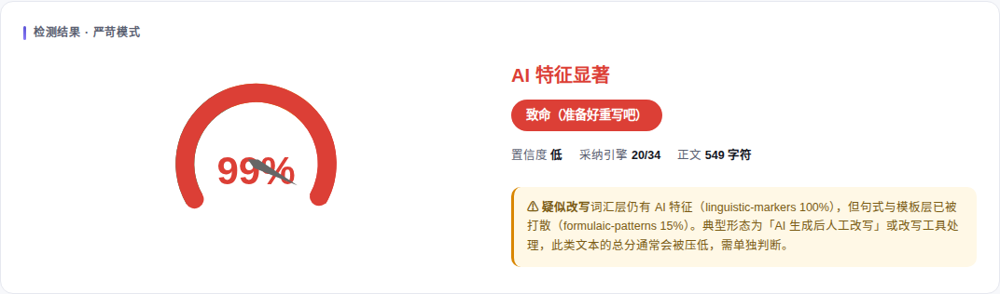
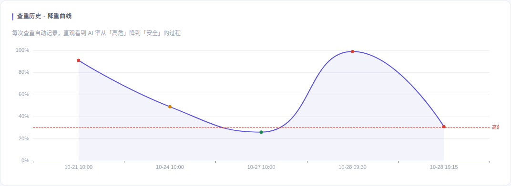

# Aurora Check

> **A more honest AI-writing detector than Turnitin — it shows you *how* the score is computed, and *how* to fix it.**


Aurora Check is an **open-source, fully local** self-checking toolkit for academic writing: AI-writing-fingerprint screening + Crossref keyword-level reference matching + DOI/reference verification + one-click **humanizing rewrite**. It combines **36 detection signals**, a ModernBERT ML classifier, MLM pseudo-perplexity, and **calibration on 52 real human papers** — all running locally with reproducible results. It lays out exactly how every score was computed, instead of throwing a single percentage at you the way commercial products do.

---

## ⚠️ Read This First: What It Is and Is Not

> **In one line: this is an assistive screening prototype, not a plagiarism system, and it can never serve as evidence of academic misconduct.**

| | What it **does** | What it **does NOT** do |
|---|---|---|
| **AI fingerprints** | ✅ Multi-engine ensembled **risk intensity** with a reproducible evidence chain | ❌ It cannot prove "this was written by AI" — see below |
| **External similarity** | ✅ (optional, needs network) keyword-level matching of long sentences against the Crossref scholarly database, returning suspected sources (title + DOI) | ❌ Not verbatim text comparison; **does not constitute a plagiarism finding**. Off by default (`external_similarity` is always `None` = "not checked", not "0% match") |
| **Internal self-overlap** | ✅ Detects duplication between paragraphs inside one document | ❌ Not equivalent to plagiarism checking |
| **Reference verification** | ✅ DOI registration status, journal profile (h-index / abnormal annual output / citation percentile), APA citation style checks | ❌ No full-text similarity, no publication-ethics judgement beyond retractions |

### 🚫 Three Hard Limitations (Please Understand These)

1. **AI-detection intensity ≠ probability.** The built-in `_positive_predictive_value()` openly admits: in low base-rate settings, **roughly six out of ten texts flagged as AI may actually have been written by humans**. It can only suggest "worth a human look", never an accusation, a deduction of marks, or a disciplinary sanction.
2. **There is no external corpus.** The word "plagiarism" in the name is a historical leftover. This tool does not do plagiarism matching — for that, use Turnitin / iThenticate or another system that actually holds a licensed corpus.
3. **The calibration sample is small.** Key thresholds were fitted on 5 AI + 1 human English academic samples (now extended to 52 real papers for pseudo-perplexity), so overfitting risk remains; for a different domain (Chinese / news / code) you must re-calibrate on your own corpus.

**Any finding of academic misconduct must go through "human review + appeal process + calibration report"; at most, this tool supplies the screening hints for one step of that process.**

---

## 📖 Overview

Aurora Check is an open-source **research prototype** for screening AI-writing features and verifying academic references. It is designed to give reviewers *reproducible evidence* (which engine said what, and why) rather than a verdict.

Unlike commercial detectors (Turnitin, GPTZero, Originality.ai), Aurora Check is fully open-source, free, runs locally (optional online models), and shows its math — every score comes with the contribution of each engine.

**Not a plagiarism checker.** External similarity is `None` / NOT IMPLEMENTED by design.

### ✨ Key Features

- 🤖 **36 detection signals** (~24 actively weighted for English, including 6 custom engines + translationese detector + Chinese-specific engines) — statistical features + ML models + zero-shot paradigms
- 🧠 **ML classifier (ModernBERT by default)** — a real deep learning model, not just simple statistical rules; configurable via `AURORA_AI_MODEL`
- 📚 **Calibrated on 52 real papers** — pseudo-perplexity and statistical-engine thresholds re-fitted on genuine human academic literature, eliminating the cross-document "invisible jump"
- 🆕 **6 novel engines** — human imperfection, emotion curve, specific details, self-reference, logical connectors, hidden watermark
- 🔬 **Zero-shot detection paradigms** — PAWN perplexity weighting, SpecDetect signal processing, DNA-DetectLLM repair-based detection
- 🛡️ **Adversarial robustness** — adversarial perturbation detector to resist paraphrasing attacks
- 🌐 **Multi-language support** — dedicated Chinese AI-detection engine
- 🔍 **Statistical watermark detection** — green/red-list statistical watermarks, not just zero-width characters
- 🌏 **Translationese detector** — catches DeepL-style machine-translation fingerprints (preposition-fronted clauses, long passives)
- ✍️ **Real AI humanizing rewrite (on demand)** — a "🤖 Rewrite this sentence" button beside each flagged sentence; a local Qwen2.5 produces a natural "first-year student" voice. Detection itself stays at second-level latency.
- 📈 **De-AI progress curve** — every check is recorded in SQLite; the front-end ECharts line chart shows your AI score falling from high-risk to safe
- 📊 **Engine disagreement analysis** — shows how much engines agree/disagree, distinguishing confident from conflicting engines
- 📈 **Sentence-level uncertainty** — visual confidence levels (high/medium/low) per high-risk sentence
- 🎨 **Beautiful HTML report** — Turnitin-style, with highlighted AI-suspect sentences and confidence indicators
- 🔍 **Local document comparison** — compare similarity between two documents
- 📚 **Automatic citation exclusion** — reference sections are detected and excluded automatically
- 🎓 **Academic-friendly** — optimized specifically for academic papers
- 🆓 **Completely free** — MIT license, no restrictions

---

## 📸 Screenshots

Once running, open **http://localhost:8000** — a single check renders all three visualizations:

| Dashboard | Engine Radar | History · De-AI Curve |
|---|---|---|
|  |  |  |

> These are real runtime captures: the dashboard and radar show a strict-mode check of a typical AI-styled passage (99% on the gauge); the de-AI curve shows one draft's full week — from 91% down into the safe band. The 99% spike on 10-28 morning is a final strict-mode re-check made right before submission.

---

## 🚀 Quick Start

### Docker (recommended — for anyone without a Python environment)

```bash
docker compose up --build
```

Then open **http://localhost:8000** and paste your text. The first start pulls the image, installs dependencies, and downloads ~2GB of detection models into your local HuggingFace cache (`~/.cache/huggingface`, mounted into the container, so restarts and rebuilds never re-download).

> Slow model download behind the Great Firewall: edit `docker-compose.yml` and uncomment `HF_ENDPOINT: https://hf-mirror.com` to use the mirror. The cache lives on the host, so deleting the container does not lose it.

### Installation

```bash
git clone https://github.com/lai123434/aurora-check.git
cd aurora-check

pip install -r requirements.txt
```

### Basic Usage

```bash
python aurora_check.py examples/sample_essay.txt
# Automatically generates both Markdown and HTML reports
# The HTML report is saved next to the input
```

### Optional: Perplexity Model (strongly recommended for Chinese)

```bash
python download_model.py     # ~950MB, downloaded from ModelScope
```

With it installed, detection gains a **"language-model perplexity"** signal — it measures how "smooth" a passage is to a language model. This is the single most paraphrase-robust signal: rewriting can change wording and syntax, but it cannot change the probability distribution of "what word comes next".

Measured (Qwen2.5-0.5B, Chinese):

```text
Standard AI output        perplexity  6.3 ~ 13.0
Human-disguised AI                   14.4 ~ 59.7
Real human                           22.9 ~ 116.5
```

It counts as **one-sided evidence only**: low perplexity is evidence of "looks AI"; high perplexity only means "does not look model-written" and cannot prove a human wrote it — humans can write very smoothly too. So anything above the threshold simply opts out.

It works without installing the model; you just lose this one signal. The model is ~944MB and is not stored in the repository.

### Web UI

```bash
pip install -r requirements-web.txt
python server.py         # → http://127.0.0.1:8000
```

Paste your text in the box and pick **normal (balanced)** or **strict (paranoid)** mode. The report is interactive: an ECharts gauge + engine radar + red-underlined high-risk sentences (hover to see "how to fix").

Strict mode also attaches an instant "how to fix" strategy plus a rule-based rewrite suggestion to every flagged sentence (swap fancy words for plain ones, split long sentences — served instantly so it never slows detection). Each flagged sentence also gets a **"🤖 Rewrite this sentence"** button: clicking it calls the local LLM on demand for a smoother humanized rewrite, while the check itself keeps returning in seconds (rewriting is a separate request the user initiates).

**Concurrency-safe**: a backend global semaphore plus a front-end queue — clicking several buttons queues them instead of hammering the CPU into a 504. A top-level **"🤖 Rewrite top 3 (≈60 s)"** button hits the batch endpoint for three results at once.

ECharts is inlined locally, so exported standalone HTML renders fully even offline. Everything runs on your machine; your documents never leave the device.

### Web API (FastAPI)

```bash
python server.py                    # or: uvicorn server:app --reload
```

```bash
# Submit text, get the full JSON report
curl -X POST http://127.0.0.1:8000/api/check \
  -H "Content-Type: application/json" \
  -d '{"text": "Your article...", "mode": "strict"}'

# Upload a file (mode as a query parameter)
curl -X POST "http://127.0.0.1:8000/api/check-file?mode=strict" \
  -F "file=@paper.docx"
```

| Endpoint | Method | Description |
|---|---|---|
| `/` | GET | Visual home page |
| `/api/check` | POST | `{"text", "mode"}` → full JSON via `CheckReport.to_dict()` |
| `/api/check-file` | POST | Upload `.txt/.md/.docx`, `?mode=strict` |
| `/api/rewrite` | POST | `{"sentence"}` → on-demand AI humanizing rewrite (local LLM, falls back to rule-based; queued by a global semaphore) |
| `/api/rewrite-batch` | POST | `{"sentences": [...]}` → batch rewrite (max 3 sentences, serialized internally) |
| `/api/history` | GET | The 10 most recent checks (powers the de-AI curve) |
| `/api/health` | GET | Health check |

> Models are slow on CPU, so endpoints dispatch via `asyncio.to_thread` into a thread pool and never block the event loop; `run_check`'s ContextVar + LRU cache are isolated per thread and thread-safe.

### Benchmark

```bash
python benchmark.py
```

Prints per-sample scores, human/AI bands, AUC and decision accuracy over `examples/benchmark/`. Filename prefixes act as labels (`human_*` / `ai_*` / `paraphrased_*`); drop in your own samples to extend it.

### Local Two-Document Comparison (you supply the reference)

```bash
python aurora_check.py compare document1.txt document2.txt
```

> **Boundary**: this compares similarity between **two local documents you provide** — a genuinely working feature. But it is **not plagiarism checking** — the tool never queries external databases or web corpora. For real plagiarism checking, feed candidate papers in as "reference documents", or use a system that holds a corpus license.

---

## 🧠 Detection Engines Explained

Aurora Check ships **36 detection signals** (~24 actively weighted for English + 2 Chinese-specific + several retired engines with weight 0), plus an optional ML classifier as the primary anchor. Core engines fall into two categories:

> **Key: thresholds are no longer guessed.** Since 3.13, pseudo-perplexity and statistical-engine weights are re-calibrated against **52 real human English academic papers** (Europe PMC + PLOS, ~330k words), removing the overfitting that made verdicts jump between documents. Calibration lives in `corpus/calibration.json` and is loaded automatically; to re-fit on your own corpus, run `python collect_corpus.py` then `python calibrate_corpus.py`.

### Category 1: Machine Learning Models (highest weight)

| Engine | Description | Source |
|--------|-------------|--------|
| **ML AI Detector (ensemble)** | Default: ModernBERT (2024, trained on MAGE+RAID) as **primary**, plus `Hello-SimpleAI/chatgpt-detector-roberta` as an **independent second opinion** for cross-validation. The two differ in architecture and training data and cover each other's blind spots; the legacy model is deliberately *not* primary. Customize the chain with `AURORA_AI_MODEL="a|b|c"`. | GeorgeDrayson/modernbert-ai-detection-raid-mage |
| **MLM Pseudo-Perplexity** | Targets "performed imperfection" human-mimicking AI: deliberately rough on the surface, yet still over-predictable underneath statistically. Separation is large: **AI ≈ 152–451 vs human ≈ 9200**. After calibration on 52 real papers, the sensitive band moved down from 1650 to **700** (misjudgement rate on real papers fell from 13% to 2%). Re-fit per domain with `AURORA_PPL_PIVOT` / `AURORA_PPL_SCALE`; swap backbones with `AURORA_PPL_MODEL`. | answerdotai/ModernBERT-base |

### Category 2: Statistical Feature Engines (reverse-engineered from multiple open-source projects)

| Engine | Description | Source |
|--------|-------------|--------|
| **lmscan** | Local statistical feature detection (Zipf deviation, slop word density, burstiness, etc.) | stef41/lmscan |
| **formulaic-markers** | AI common phrase detection (delve, nuanced, testament to, etc.) | lynote-ai/ai-text-detector |
| **transition-density** | Transition word density detection (first, moreover, however, etc.) | lynote-ai/ai-text-detector |
| **compressibility** | Compression ratio detection (AI text compresses better) | lynote-ai/ai-text-detector |
| **structured-shape** | List/heading structure detection | lynote-ai/ai-text-detector |
| **formulaic-patterns** | AI opening/closing template detection | pablocaeg/sloptotal |
| **linguistic-markers** | Weighted AI vocabulary detection (100+ marker words, 3 tiers) | pablocaeg/sloptotal |
| **vocabulary-richness** | Vocabulary richness detection (Root TTR, Hapax ratio, Yule's K) | pablocaeg/sloptotal |
| **structural-patterns** | Structural feature detection (colon density, list density, paragraph uniformity) | pablocaeg/sloptotal |
| **sentiment-hedging** | Sentiment and hedging detection (over-hedging, vague positivity, filler qualifiers) | pablocaeg/sloptotal |
| **human-imperfection** | **Novel!** Human imperfection detector: the more "perfect" a text is, the more likely it is AI | **Custom innovation** |
| **emotion-curve** | **Novel!** Emotion curve detector: AI emotion is flat, humans have ups and downs | **Custom innovation** |
| **specific-details** | **Novel!** Specific details detector: humans use many concrete numbers/names, AI stays abstract | **Custom innovation** |
| **self-references** | **Novel!** Self-reference detector: humans say "I think", AI rarely does | **Custom innovation** |
| **logical-connectors** | **Novel!** Logical connectors detector: AI overuses "therefore/however", humans use fewer | **Custom innovation** |
| **ngram-perplexity** | N-gram language model perplexity | Custom |
| **sliding-window** | Paragraph-level sliding window detection | Custom |
| **burstiness-stat** | Traditional sentence length burstiness detection | Custom |
| **statistical-baseline** | Statistical baseline detection | Custom |

---

## 🌐 Networking & Mirrors

The `ml-detector` engine pulls the ModernBERT detector from HuggingFace by default and **requires network access**. The other ~30 statistical engines work fully offline; with no network, the ML item is skipped and scoring continues normally.

- **Automatic mirror fallback**: if `huggingface.co` is unreachable (common behind restricted networks), the engine **automatically switches** to the `hf-mirror.com` mirror — no manual setup. Only if the mirror is also unreachable is the ML engine skipped.
- **Manual mirror / custom model**:
  ```bash
  export HF_ENDPOINT=https://hf-mirror.com   # force the mirror
  export AURORA_AI_MODEL=your-model-id       # override the default ModernBERT (pipe-separated fallback chain)
  ```
- **Local cache reuse**: models are cached in `~/.cache/huggingface` after the first download and load offline afterwards. The loader is **cache-first** (tries local, skips the hub etag check), so once downloaded, models run fine with no network; network probing happens only when a new download is needed.
- **Missing engines are transparent**: any engine that fails to produce a score (model unreachable, `lmscan` CLI missing, `lm-perplexity` enabled only for Chinese, etc.) is listed by name with its reason under **"Engines not participating in this check"** — never silently skipped. You always know which engines ran and which are missing.
- **Cross-validation across detectors**: to counter the style blind spots of any single classifier, you can mount several at once:
  ```bash
  export AURORA_AI_MODEL="GeorgeDrayson/modernbert-ai-detection-raid-mage|Hello-SimpleAI/chatgpt-detector-roberta"
  ```
  **All** models in the chain are loaded: the first valid result acts as **primary anchor** for 50% of the weight, the rest act as **second opinions** — the verdict is pulled back to "needs human review" only when the primary may be in a blind spot (≤0.45) while another detector reports high risk (≥0.60), avoiding confident misjudgements.
- **Measured (human-mimicking AI stress test, see CHANGELOG 3.3.0)**: for purely AI-generated human-mimicking text, before the upgrade **4 of 5 samples were confidently judged human (total misses)**; after it, blatant AI is still caught as `ai`, and the remaining human-mimicking AI **all land in `mixed` for human review** — no more confident false-human.
- **⚠️ Recall-first trade-off**: to eliminate misses, genuine human samples are also pushed into the `mixed` band. If your use case cares more about "not hurting real humans", lower the `ml-detector` / `mlm-perplexity` weights; the default setting follows "better review than let it pass".
- **Measured** (ModernBERT, via `hf-mirror.com`): blatant AI-styled text scores ≈ **0.99** on ML, natural human text ≈ **0.45** — strong separation.

---

## 📊 Output Example

### Markdown Report

```
# Aurora Check Report

- **Text Length:** 1200 characters

## AI Detection

- **Overall Verdict:** Likely human-written
- **AI Probability:** 12.5%
- **Human Probability:** 87.5%
- **Method:** ensemble (15 engines, references excluded)

- **Individual Engine Scores:**
  - ml-detector: 8.2%
  - lmscan: 6.7%
  - formulaic-patterns: 0.0%
  - ...

- **High-Risk Sentences (Top 5):**
  - (0.65) This is a sample sentence...
  - ...
```

### HTML Report

The generated HTML report features:

- 🎨 Gradient purple-blue header
- 📊 Large AI score display (red/yellow/green color coding)
- 📈 Detailed score bars for each engine
- 🔴 Highlighted high-risk sentences
- 📱 Responsive design, works on mobile

---

## 🔧 Advanced Usage

### Python API

```python
from aurora_check import run_check

# Detect AI content (mode="normal" balanced / "strict" paranoid)
report = run_check(text="Your text here...", mode="strict")

# AI probability
ai_prob = report.ai.ai_probability

# High-risk sentences (in strict mode each carries a "strategy" for how to fix
# it and a "rewrite_suggestion" you can paste directly)
flagged = report.ai.flagged_sentences

# Interactive HTML report (ECharts radar + gauge + per-sentence bubbles)
html = report.to_html()

# Export as dict for a JSON API
data = report.to_dict()
```

### Adjusting Engine Weights

You can tune each engine's weight to taste. Find the `weights` dictionary in `aurora_check.py`:

```python
weights = {
    "ml-detector": 0.25,          # ML model weight (ModernBERT by default, configurable)
    "lmscan": 0.20,               # lmscan weight
    "formulaic-patterns": 0.12,   # Formulaic patterns weight
    # ... other engines
}
```

---

## 📋 Tier Positioning

| Tier | Representative Software | Features |
|------|------------------------|----------|
| **Tier 1** | Turnitin, GPTZero, Originality.ai | Multiple pre-trained models + full-web comparison + commercial support |
| **Tier 2** | **Aurora Check** | 29-engine ensemble + ModernBERT ML model + local comparison |
| **Tier 3** | Simple single-engine detectors | Only one or two statistical rules |

---

## 📊 Measured on This Build

### English (`python benchmark.py`, corpus ships with the repo)

```text
Human band     0.163 ~ 0.284
AI band        0.456 ~ 0.781
Gap            +0.172
AUC            1.000  (n=9 — small sample, regression baseline only)
```

### Chinese (locally measured; corpus not distributed for copyright reasons)

24 real Chinese articles (少数派 / 36氪 / 简书) + 8 generative-model outputs:

```text
                          Mean     Band              Detected (≥0.5)
Standard AI output        0.667    0.585 ~ 0.775     8/8
Human-disguised AI        0.611    0.494 ~ 0.672     3/4
Real human                0.249    0.129 ~ 0.375     0/24 (zero false positives)
```

The third group is an **adversarial test**: deliberately adding colloquialisms, inventing concrete numbers and shuffling paragraphs to imitate human style. It probes the ceiling of statistical detectors — surface features alone can always be bypassed by rewriting.

The one signal that held up is `zh-char-entropy` (character-level 3-gram entropy): AI text sits at 8.4–8.7 bits, humans at 10.5. A few colloquial sentences cannot shift the character distribution of a whole document, and this single signal lifted adversarial-sample recall from 50% to 75%.

Chinese is not a by-product of the English engines: English word lists (delve / furthermore) score a constant 0 on Chinese, so it must be modeled separately. The Chinese engine relies on six signal groups — template connectives, abstract officialese, colloquial markers, concrete numbers, sentence-length variance, and quote density — and automatically drops English word-list engines to 20% weight when Chinese is detected.

---

## ⚠️ Known Limitations

Measured on 6 texts of known origin (see `test_regression.py`):

| Issue | Detail |
|---|---|
| **Paraphrased AI text is not detected** | Rewriting destroys sentence rhythm, template and emotion signals. Total score drops into the human band. Use the `rewrite_hint` field instead of the raw score. |
| **Non-native academic writing skews "human"** | Engines such as `formulaic-markers` use native-English marker lists; ESL writing scores 0 on them. |
| **Short texts are unreliable** | Below ~200 characters the tool refuses to output a score (see the `note` field). |
| **Absolute scores are not probabilities** | Do not read "43%" as "a 43% chance of AI". Only relative comparison between texts is meaningful. |

Regardless of score, **defer to human judgement** for academic-integrity decisions.

---

## 🤝 Contributing

We welcome any form of contribution!

### How to Contribute

1. Fork this repository
2. Create your feature branch (`git checkout -b feature/AmazingFeature`)
3. Commit your changes (`git commit -m 'Add some AmazingFeature'`)
4. Push to the branch (`git push origin feature/AmazingFeature`)
5. Open a Pull Request

### Want to Add a New Engine?

1. Add a new detection function in `aurora_check.py`
2. Register the new engine in `run_ai_detection`
3. Adjust the weight in the `weights` dictionary
4. Test to ensure existing functionality is not broken

---

## 📜 License

This project is licensed under the MIT License — see the [LICENSE](LICENSE) file for details.

---

## 🙏 Acknowledgments

### Open Source Contributors

This project reverse-engineered and integrated core algorithms from the following open-source projects. We thank their authors:

- [lynote-ai/ai-text-detector](https://github.com/lynote-ai/ai-text-detector) — 6-signal detection algorithm
- [pablocaeg/sloptotal](https://github.com/pablocaeg/sloptotal) — 24-engine ensemble approach
- [stef41/lmscan](https://github.com/stef41/lmscan) — local statistical feature detection
- [DW-Studio/sloplint](https://github.com/DW-Studio/sloplint) — Chinese AI-flavour feature list (2.83M-word contrast corpus)
- [GeorgeDrayson/modernbert-ai-detection-raid-mage](https://huggingface.co/GeorgeDrayson/modernbert-ai-detection-raid-mage) — default ML detector (ModernBERT, MAGE+RAID trained, generalizes to modern LLMs)
- [Hello-SimpleAI/chatgpt-detector-roberta](https://huggingface.co/Hello-SimpleAI/chatgpt-detector-roberta) — legacy RoBERTa ChatGPT detector used as fallback
- [followsci/bert-ai-text-detector](https://huggingface.co/followsci/bert-ai-text-detector) — BERT academic text detection model

### On AI Scores: A Real Story of Getting It Wrong

This project was born from the author's own painful attempts to humanize a draft. The same assignment walked its AI score from **57% → 19.6% → 34%**:

- **57%**: the first draft was straight AI output, AI features maxed out.
- **19.6%**: after furiously deleting fancy words, stuffing in colloquialisms and flattening templates, the score fell to 19.6% — yet the teacher spotted "this doesn't sound human" at a glance, because over-humanizing had distorted it instead.
- **34%**: recovering the real student voice — keeping a few small mistakes, keeping some Chinglish, keeping personal details — the score stabilized around 34%.

**Conclusion: a lower AI score is not better.** A first-year student who scored 90 in the Gaokao English exam will naturally produce work carrying a little "human imperfection", which detectors read as the ~30% `mixed` band. Forcing the AI score into single digits just exposes that you "over-edited". **34% is what a real student sounds like.**

### Special Thanks

> This project was developed with assistance from **Doubao AI (豆包)**. Special thanks to Doubao for invaluable help in research, coding, and project development.

---

## ⚠️ Disclaimer

Aurora Check's detection results are for reference only and cannot serve as the final verdict on academic integrity. AI detection technology is still evolving rapidly, and no tool can achieve 100% accuracy.

Always defer to human judgment.

---

## 📞 Contact

If you have any questions or suggestions, feel free to:

- Submit an Issue
- Send a Pull Request
- Or contact the project maintainer directly

---

**⭐ If this project helps you, please give it a Star!**
